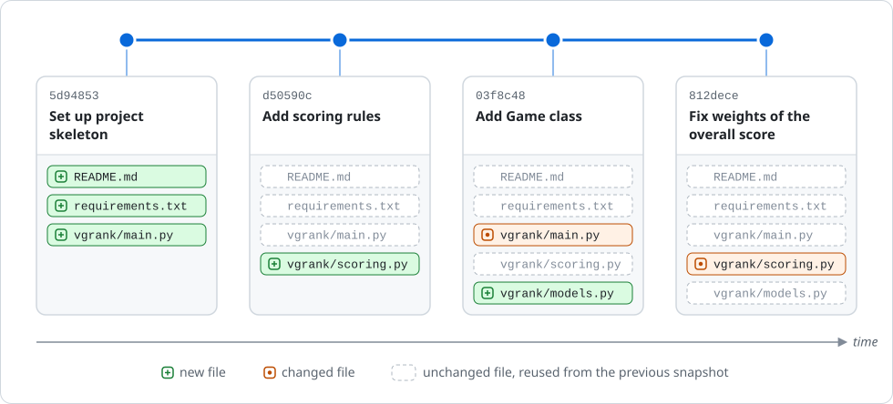
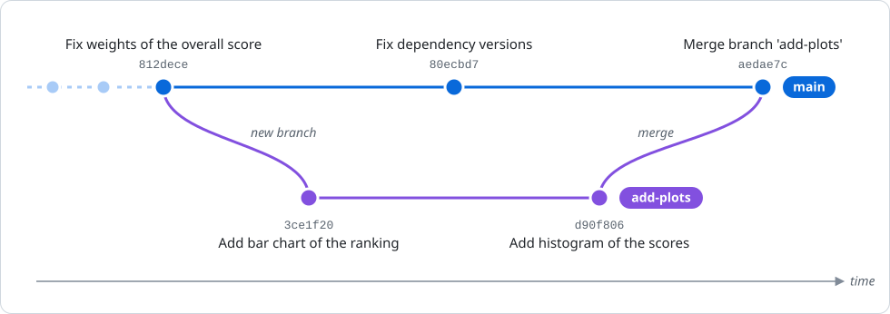

# Version Control with Git

A **Version Control System (VCS)** is a tool that helps you:

- **Keep track of every change** made to your project over time.
- **Create a coherent history** of your project, like a time machine.
- **Collaborate** with others on the same codebase without overwriting each other's work.
- **Experiment** with new features in isolation without breaking the main project.
- **Revert** to a previous working state if you introduce a bug.

## Git

**Git** is the most popular, modern **Distributed Version Control System**.

- **Version Control System:** It tracks the history of your files.
- **Distributed:** Unlike older systems, every developer has a full copy of the project's history on their local machine. This makes it fast and allows for offline work.

#### Snapshots

A project grows one step at a time: you add a feature, you fix a bug, you update the documentation. Each time you complete a step, you can take a **snapshot** of your project, i.e., a picture of what all your files look like at that moment: Git calls it a **commit**. Each commit records:

- the content of **all the files** of the project, not only of the ones that you changed;
- a unique **ID**, the **author** and the **date**;
- a **message** that describes the step (e.g., `Add scoring rules`);
- a reference to the previous commit (its **parent**), which links the commits into the **history** of the project.



In the figure, each dot is a commit, with its snapshot below: the highlighted files are the ones that the commit added or changed, while the others are the same as in the previous snapshot. Each commit corresponds to one step (the setup, two new features, a fix), so that the history reads like the story of the project.

Thanks to the history, you can see what your project looked like at any moment, compare two snapshots, and undo a single step (e.g., a fix that broke something else) without losing the steps that came after it.

> **NOTE**: a snapshot doesn't duplicate the whole project. If a file didn't change, Git simply reuses the version that it has already stored: this is why even a long history takes little space.

In the rest of the lecture, we will see the commands to take snapshots ([A Local Repository](#a-local-repository)), to develop several features in parallel ([Branching and Merging](#branching-and-merging)), and to share your history on GitHub ([Working with Remotes](#working-with-remotes-github)).

## Setup

Before you use Git, you need to install it and configure it.

#### Installation

- **Windows:** download and install [Git for Windows](https://git-scm.com/downloads). Besides Git, it includes **Git Bash**, a shell with the same commands as macOS and Linux, and the **Git Credential Manager**, which logs you in to GitHub (see [Authentication](#authentication)). During the installation, you can already choose *nano* as Git's default editor, and *main* as the name of the initial branch (see the configuration below).
- **macOS:** run `git --version` in the terminal. If Git is missing, macOS offers to install the *Command Line Developer Tools*, which include it.
- **Linux (and WSL):** install it with the package manager of your distribution, e.g. `sudo apt install git` on Ubuntu.

Then, check that your shell can find Git:

```bash
git --version
# git version 2.x.y
```

#### Configuration

Open your shell (Terminal, Git Bash, etc.) and introduce yourself to Git. This information will be attached to every commit you make.

```bash
# Set your name for all repositories on this machine
git config --global user.name "Your Name"

# Set your email for all repositories on this machine
git config --global user.email "youremail@example.com"
```

> **NOTE**: use the same email as your GitHub account, so that GitHub links your commits to your profile. If you prefer to keep your email private, use the `noreply` address that GitHub shows you in *Settings → Emails*.

A few more settings will save you some trouble later:

```bash
# Call 'main' the first branch of every new repository (otherwise, it may be called 'master')
git config --global init.defaultBranch main

# Use nano whenever Git asks you to write a message (the default editor is often vim)
git config --global core.editor "nano"

# When pulling, merge the remote changes with yours (see "Push, Fetch, Pull")
git config --global pull.rebase false

# Check your configuration
git config --global --list
```

This is a one-time setup.

> **NOTE**: if you ever end up in vim anyway, press `Esc`, type `:wq` and press `Enter` to save and quit.

## A Local Repository

In the shell lecture, we created the skeleton of the `vgrank` project. Let's track it with Git (or track your own project, if you created it!).

#### Initialize a Repository
Navigate to the root folder of your project and run `git init`.

```bash
# Move to the project folder, and check that you are in the right place
cd ~/projects/vgrank
pwd

# Tell Git to start tracking this directory
git init
```
This command creates a hidden sub-directory named `.git` (run `ls -a` to see it). This is where Git stores all the history and metadata for your project. **Never manually delete or edit files in the `.git` directory!**

> **NOTE**: run `git init` only in the root folder of your project: in the wrong folder (e.g., your home directory), Git would start tracking all the files below it.

#### The Three Areas
Git doesn't take snapshots on its own: you decide when to take one, and what goes into it. To do so, Git manages your project in three main areas:

1.  **Working Directory:** All the files you can see and edit in your project folder.
2.  **Staging Area (or Index):** A "drafting" area where you prepare the changes for your next snapshot (commit).
3.  **Repository (.git directory):** Where Git permanently stores your committed snapshots.


As a consequence, each file of your project can be:

- **untracked:** a new file, that Git sees but does not track yet;
- **modified:** changed in the working directory, but not staged yet;
- **staged:** marked to go into your next commit;
- **committed:** safely stored in the repository.

The command `git status` is your best friend. It tells you the current state of your files.

```bash
git status
```
Git will report `README.md`, `requirements.txt` and `vgrank/` as "untracked files". Git sees them but isn't tracking their changes yet.

> **NOTE**: the empty folders `data/` and `notebooks/` are not listed. Git tracks files, not folders: an empty folder is ignored until you put a file in it.

#### Staging Changes with `git add`
To include changes in your next commit, you first need to add them to the Staging Area. This is done with the `git add` command.

```bash
# Add specific files to the staging area
git add README.md requirements.txt vgrank/main.py

# You can also add all new and modified files in the current directory and its subdirectories
# git add .
```
Now, run `git status` again. You'll see that the three files are now listed under "Changes to be committed".

> **NOTE**: `git add .` adds everything that is not ignored (see [`.gitignore`](#gitignore)): always check with `git status` what you are about to commit.

#### Committing Changes with `git commit`
A **commit** is the act of taking the snapshot of your Staging Area and permanently saving it to your repository's history. Each commit has a unique ID (a hash, often shortened to its first 7 characters, e.g. `1ad0b34`), an author, a date and a descriptive message.

```bash
# Commit the staged changes with a message
git commit -m "Set up project skeleton"
```

**Good commit messages are crucial**: they turn your history into a readable story of your project.

- The first line is a short summary (50 characters or less), written in the imperative mood, as if you were giving an order: `Add function to load the dataset`, rather than `Added stuff` or `update`.
- If you need to explain *what* changed and *why*, leave a blank line after the summary and add a more detailed description. The `-m` flag is handy for one-line messages: for a longer one, run `git commit` without `-m`, and Git will open the editor (nano), where you can write the full message. Then press `Ctrl + X`, `Y` and `Enter` to save it and complete the commit.
- Each commit should be **atomic**, i.e., contain one logical change (a new function, a bug fix, a new section of the README), rather than a whole day of unrelated work. Commit often: small commits are easier to describe, to review and to undo. If you worked on two changes at once (e.g., a new plot and a bug fix, in different files), stage and commit them one at a time: this is what the staging area is for.

Have a look at the [history of vgrank](https://github.com/sergiopicascia/vgrank/commits/main) for an example.

#### Viewing History with `git log`
You can view the history of commits using `git log`.

```bash
# Show the full commit history
git log

# A more concise and graphical view of the history
git log --oneline --graph --all
```
This will show you a list of all your commits, from the most recent, with their unique IDs, author, date, and message.

For instance, for the history in the figure of [Snapshots](#snapshots), the second command prints one line per commit, with its ID and its message:

```text
* 812dece (HEAD -> main) Fix weights of the overall score
* 03f8c48 Add Game class
* d50590c Add scoring rules
* 5d94853 Set up project skeleton
```

Each `*` is a commit, and `HEAD -> main` marks where you are: on the `main` branch, at its last commit. With more branches, the column of `*` becomes a graph (see [Merging Branches](#merging-branches)).

> **NOTE**: when the history doesn't fit in the screen, Git shows it with `less`, like we saw in the shell lecture: scroll with the arrow keys, and press `q` to quit.

#### Checking Differences with `git diff`
What if you've made changes but haven't staged them yet? `git diff` shows you the exact lines that have changed.

```bash
# Let's modify our script, appending a new line
echo 'print("Let the ranking begin!")' >> vgrank/main.py

# See the changes that are not staged yet (working directory vs. staging area)
git diff
```
This will show you the new line, marked with a `+` (removed lines are marked with a `-`).

Once a change is staged, `git diff` doesn't show it anymore: `git diff --staged` shows you instead what is going into the next commit.

```bash
git add vgrank/main.py

# Nothing to show: all the changes are staged
git diff

# See the staged changes (staging area vs. last commit)
git diff --staged

git commit -m "Add welcome message"
```

You have just completed the everyday Git workflow: **edit** your files, **check** them with `git status` and `git diff`, **stage** them with `git add`, and **commit** them with `git commit`.

#### Undoing Changes
Git is your safety net. These commands undo the most common mistakes:

```bash
# Unstage a file: its changes stay in the working directory
git restore --staged vgrank/main.py

# Discard the changes to a file that you haven't staged yet
# CAREFUL: the discarded changes are lost forever
git restore vgrank/main.py

# Undo a commit, by creating a new commit that does the opposite
git revert <commit-id>
```
`git revert` takes one of the IDs shown by `git log --oneline` (e.g., `git revert a1b2c3d`), and opens the editor with a default message: press `Ctrl + X` to accept it. The original commit stays in the history, so it is safe to use even after you have shared your work.

## Branching and Merging

So far, we've been working on a single timeline, the `main` branch. But the history doesn't have to be a straight line.

A **branch** is an independent line of development. You create branches to work on new features or fix bugs without disturbing the stable code on the `main` branch. For instance, after the commits in the figure of [Snapshots](#snapshots), you can develop the plots of vgrank on a new branch, `add-plots`, while `main` keeps a working version of the code: in the meantime, you can still fix a bug on `main`. When the plots are ready, you **merge** `add-plots` into `main`: Git combines the changes of both branches in a new commit.



Each branch is just a label (like `main` and `add-plots` in the figure) that points to a commit: each time you commit on a branch, its label moves forward to the new commit.

#### Creating and Switching Branches
Let's say we want to add a new feature. We'll create a new branch for it.

```bash
# Create a new branch called 'add-greeting'
git branch add-greeting

# Switch to the new branch to start working on it
git switch add-greeting

# --- OR, do both in one command ---
# git switch -c add-greeting

# List all the branches: the current one is marked with *
git branch
```

> **NOTE**: in many tutorials you will find `git checkout <branch>` and `git checkout -b <branch>`: they are the older (still working) equivalents of `git switch` and `git switch -c`.

Now you are on the `add-greeting` branch. Any commits you make here will *not* affect the `main` branch until you decide to merge them.

Let's make a change: open `vgrank/main.py` with your editor (e.g., `nano vgrank/main.py`), and change it as follows.

```python
def greet(name):
    print(f"Hello, {name}! Let the ranking begin!")


print("Hello from vgrank!")
greet("player")
```

Now, stage and commit this change on our feature branch:

```bash
git add vgrank/main.py
git commit -m "Add greet function"
```

#### Merging Branches
Our feature is complete! Now we want to incorporate it into our main codebase. We do this by **merging**.

1.  First, switch back to the branch you want to merge *into* (our `main` branch).
2.  Then, run the `git merge` command with the name of the branch you want to merge *from*.

```bash
# Switch back to the main branch
git switch main

# Merge the changes from our feature branch into main
git merge add-greeting
```
If you now look at `vgrank/main.py` on the `main` branch, you'll see it contains the new `greet` function.

Since `main` had no new commits, Git simply moved it forward to the last commit of `add-greeting` (a *fast-forward* merge). If both branches have new commits, as in the figure at the beginning of this section, Git instead creates a new **merge commit** that combines them, and opens the editor with a default message (e.g., `Merge branch 'add-plots'`): press `Ctrl + X` to accept it.

In this case, `git log --oneline --graph --all` draws the two branches. For the history in the figure, it prints:

```text
*   aedae7c (HEAD -> main) Merge branch 'add-plots'
|\
| * d90f806 (add-plots) Add histogram of the scores
| * 3ce1f20 Add bar chart of the ranking
* | 80ecbd7 Fix dependency versions
|/
* 812dece Fix weights of the overall score
* 03f8c48 Add Game class
* d50590c Add scoring rules
* 5d94853 Set up project skeleton
```

Each `*` is a commit, with the most recent at the top, and the lines connect each commit to its parent. Reading from the bottom up: `add-plots` leaves `main` after `812dece` (`|/`), gets its two commits on the right, and joins `main` again in the merge commit `aedae7c` (`|\`), which has two parents.

Once a branch is merged, you can delete it:

```bash
git branch -d add-greeting
```

#### Merge Conflicts
Sometimes, Git can't automatically merge changes. This happens if you and someone else (or you on two different branches) changed the **same lines of the same file**. This is a **merge conflict**.

When this happens, Git will stop the merge and mark the conflicting lines in the file with conflict markers (`<<<<<<<`, `=======`, `>>>>>>>`). For example, if `main` and a branch named `new-title` changed the welcome message in two different ways, `vgrank/main.py` will contain:

```text
<<<<<<< HEAD
print("Welcome to vgrank!")
=======
print("Hello from VideoGame Ranking!")
>>>>>>> new-title
```

The lines between `<<<<<<< HEAD` and `=======` are the version of your current branch (`main`); the lines between `=======` and `>>>>>>> new-title` are the version of the branch you are merging.

Your job is to:

1.  Open the conflicted file (`git status` lists it under "Unmerged paths").
2.  Edit it to resolve the differences: decide which version to keep, or combine them, and remove the conflict markers.
3.  Save the file.
4.  `git add` the resolved file.
5.  `git commit` to finalize the merge (Git opens the editor with a default message: press `Ctrl + X` to accept it).

If you prefer to give up, `git merge --abort` brings everything back to how it was before the merge.

> **NOTE**: VS Code highlights the conflicts, and lets you solve each of them with one click (*Accept Current Change*, *Accept Incoming Change* or *Accept Both Changes*).

## Working with Remotes (GitHub)

So far, everything has been on your local machine. To back up your work and to collaborate, you need a central place to share your repository. This is where services like **GitHub**, GitLab, or Bitbucket come in. They host your Git repositories in the cloud.

A **remote** is a reference to a repository hosted on another server.

#### Authentication
GitHub does not accept your account password from the command line. The first time you push, you need to log in in one of these ways:

- **From your IDE:** VS Code and PyCharm let you sign in to GitHub through the browser, and then push and pull for you. VS Code also takes care of the `git` commands that you type in its integrated terminal.
- **Git Credential Manager:** included in Git for Windows. The first time you push, a window asks you to sign in to GitHub through the browser, and your credentials are saved for the next times.
- **GitHub CLI:** install [`gh`](https://cli.github.com/), run `gh auth login`, choose *HTTPS* and answer yes to *Authenticate Git with your GitHub credentials*.

You can also use a personal access token or an SSH key: see the [GitHub documentation](https://docs.github.com/en/get-started/git-basics/caching-your-github-credentials-in-git).

#### Pushing an Existing Local Repository
Our `vgrank` repository only exists on our computer: let's publish it on GitHub.

1.  **On GitHub:** Create a *new, empty* repository (do not initialize it with a README, a `.gitignore` or a license, otherwise its history would conflict with yours). Copy its URL, like `https://github.com/your-username/vgrank.git`.
2.  **On your local machine:**
    - Navigate to your existing project folder (the one where you ran `git init`).
    - Link your local repo to the remote one on GitHub.
    - Push your `main` branch to the remote.

```bash
# Add a remote named 'origin' pointing to your GitHub repo
git remote add origin https://github.com/your-username/vgrank.git

# Check the remotes of your repository
git remote -v

# Only if your branch is still called 'master', rename it to 'main'
# git branch -M main

# Push your main branch to the origin remote
# The -u flag links your local 'main' to 'origin/main', for future pushes and pulls
git push -u origin main
```

Refresh the page of your repository on GitHub: your files and your commits are there.

#### Cloning a Repository
To download a repository that is already on GitHub (e.g., to work on another computer, or to try someone else's project), use `git clone`.

```bash
# Clone the repository from GitHub to your machine
git clone https://github.com/your-username/vgrank.git

# This automatically creates a folder named 'vgrank'
cd vgrank
```

This downloads the whole history of the project, and automatically sets up a remote named `origin` that points to the GitHub URL.

> **NOTE**: you can also start a new project directly on GitHub: create the repository there, letting GitHub add a `README.md` and a `.gitignore` (choose the *Python* template), and then clone it.

#### Push, Fetch, Pull

-   `git push`: Sends your committed changes from your local repository to the remote repository. Your commits stay on your computer until you push them: GitHub (and your instructor) only see what you have pushed.
    ```bash
    # After 'git push -u origin main', a simple 'git push' is enough
    git push
    ```
-   `git fetch`: Downloads changes from the remote repository but *does not* merge them into your working files. It just updates your local `.git` database.
-   `git pull`: This is a combination of `git fetch` and `git merge`. It downloads changes from the remote and immediately tries to merge them into your current branch. You need it whenever the remote has commits that you don't have locally, e.g. because you edited a file directly on GitHub, or pushed from another computer.
    ```bash
    # Get the latest changes from the remote
    git pull
    ```

> **NOTE**: if `git push` is rejected because *the remote contains work that you do not have locally*, run `git pull` first (solving any conflicts; if Git opens the editor with a merge message, press `Ctrl + X` to accept it), then push again. If `git pull` stops with *Need to specify how to reconcile divergent branches*, you skipped the `pull.rebase` setting: run `git config --global pull.rebase false`, and pull again.

#### Sharing Your Project
Your repository can be **public** or **private**: you choose when you create it, and you can change it later in the *Settings* of the repository. To submit your project, invite the instructor as a collaborator (*Settings → Collaborators → Add people*): this way, you can keep your repository private, if you prefer.

## Important Files

#### `.gitignore`
There are certain files you *don't* want to track with Git:

- **secrets**, like API keys and passwords (e.g., a `.env` file);
- the **virtual environment** of your project (`.venv/`), which we will create in a moment;
- files **generated** by Python, Jupyter or your operating system, like `__pycache__/`, `.ipynb_checkpoints/` or `.DS_Store`;
- the settings of your **IDE**;
- **large data files**: explain in your README where to download them instead.

Create a file named `.gitignore` in your project's root (e.g., with `nano .gitignore`), and list the files and folders to ignore, one per line. You can use the same wildcards as in the shell (`*` and `?`); a trailing `/` matches only directories, and lines starting with `#` are comments. For Python, this is essential!

```text
# Secrets: never commit API keys
.env

# Python virtual environment
.venv/

# Python bytecode and caches
__pycache__/
*.pyc

# Jupyter checkpoints
.ipynb_checkpoints/

# IDE and OS files
.vscode/
.idea/
.DS_Store

# Large data files
data/raw/
```

Then, commit it like any other file:

```bash
git add .gitignore
git commit -m "Add .gitignore"
git push
```

GitHub maintains a complete [`.gitignore` template for Python](https://github.com/github/gitignore/blob/main/Python.gitignore), which you can also select when you create a new repository.

> **NOTE**: `.gitignore` only affects files that are not tracked yet. If you have already committed a file (e.g., your `.env`), adding it to `.gitignore` is not enough: stop tracking it with `git rm --cached .env` (or `git rm -r --cached <folder>` for a folder), then commit. The file stays on your disk, but it is still in the previous commits: if it contained a secret, consider it leaked, and generate a new one.

#### `README.md`
A Markdown file that explains what your project is, where its data comes from, which libraries it uses, and how to install and run it. This is the first thing people see on GitHub: have a look at the one of [vgrank](https://github.com/sergiopicascia/vgrank).

#### `LICENSE`
A file that specifies how others are allowed to use your code (e.g., MIT, Apache 2.0).

## Git in Your IDE

Modern code editors like VS Code and PyCharm have excellent integration with Git. They provide a graphical user interface (GUI) to stage changes, commit, push, pull, and manage branches. This can be a great way to visualize what's happening. In VS Code, the *Source Control* view can also publish a local repository on GitHub with a single click (*Publish Branch*), taking care of the authentication.

## Useful Resources

- [Git Installation](https://git-scm.com/downloads)
- [Pro Git](https://git-scm.com/book/en/v2): the free, official book on Git
- [Branches in a Nutshell](https://git-scm.com/book/en/v2/Git-Branching-Branches-in-a-Nutshell): how Git stores snapshots and branches
- [Learn Git Branching](https://learngitbranching.js.org/): an interactive tutorial on branches
- [Create a Remote Repository](https://docs.github.com/en/repositories/creating-and-managing-repositories/creating-a-new-repository)
- [Local Repository to GitHub](https://docs.github.com/en/migrations/importing-source-code/using-the-command-line-to-import-source-code/adding-locally-hosted-code-to-github)
- [Cloning a Remote Repository](https://docs.github.com/en/repositories/creating-and-managing-repositories/cloning-a-repository)
- [Authenticating with GitHub from Git](https://docs.github.com/en/get-started/git-basics/caching-your-github-credentials-in-git)
- [Inviting Collaborators](https://docs.github.com/en/repositories/managing-your-repositorys-settings-and-features/repository-access-and-collaboration/inviting-collaborators-to-a-personal-repository)
- [Git in VSCode](https://code.visualstudio.com/docs/sourcecontrol/overview)
- [Git in PyCharm](https://www.jetbrains.com/help/pycharm/set-up-a-git-repository.html#add-remote)
