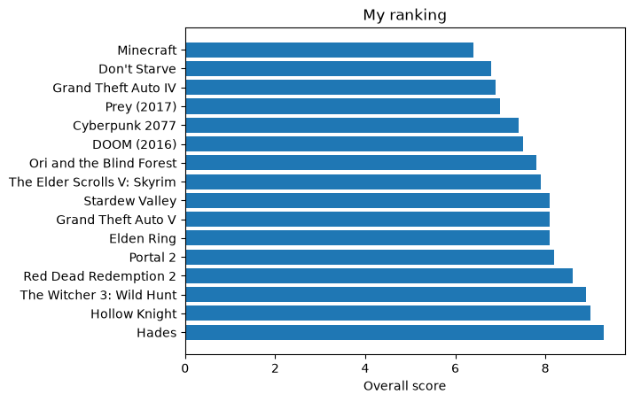
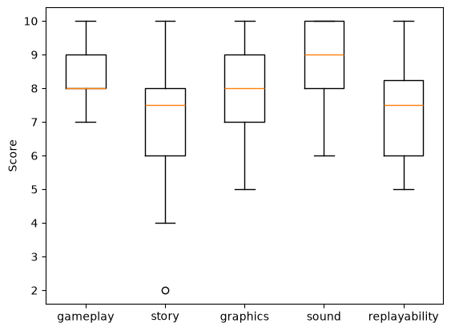
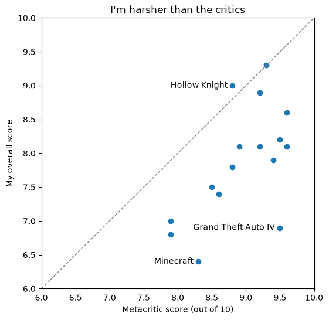
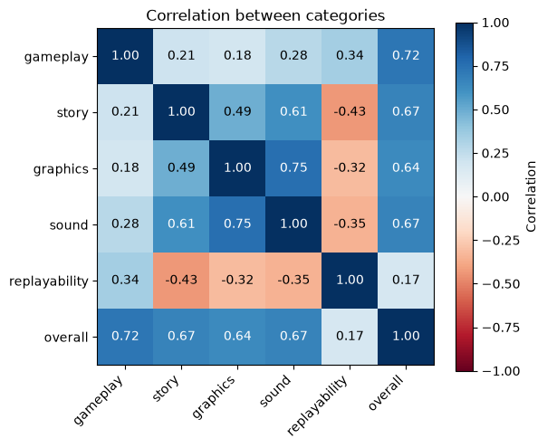
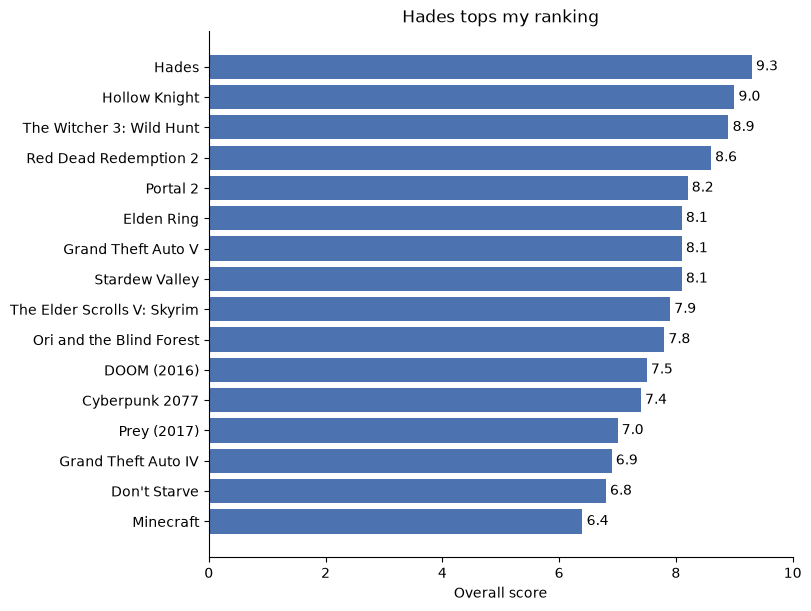
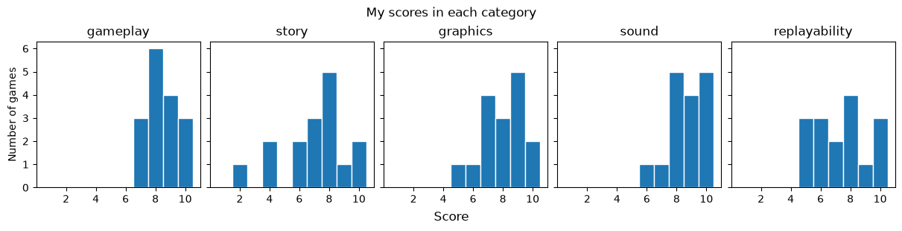
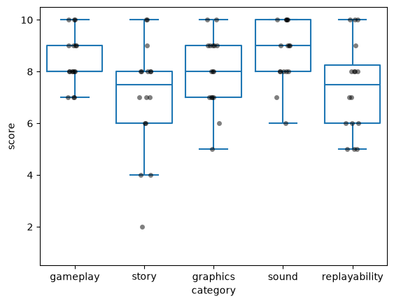

# Data Visualisation with matplotlib

A chart shows at a glance what a table hides: a trend, a difference between two groups, a value far from the others. It's also the most effective way to communicate a result, provided that it's clear: a chart that needs a long explanation, or that can be misread, doesn't do its job.

**matplotlib** is the standard plotting library of Python: pandas and seaborn draw their charts with it, and most of the plotting code that you'll find online uses it. It can draw almost any chart, and every detail of a chart can be changed.

This lecture covers how matplotlib builds a chart, which chart answers which question, how to make a chart clear, how to put several charts in one figure, and how to plot with pandas and seaborn; then, briefly, interactive charts with Plotly.

## Figures and Axes

#### Getting Started

matplotlib is not installed together with pandas: install it with `pip install matplotlib`, and add it to your `requirements.txt`. Its plotting functions are in the `pyplot` module, conventionally imported as `plt`.

The examples run from the root of vgrank, as in the previous lectures. vgrank draws its charts with Plotly (see [below](#interactive-charts-with-plotly)), so matplotlib is not in its `requirements.txt`: to run the examples, install it in its environment, together with seaborn (`pip install matplotlib seaborn`). They start from the ranking:

```python
import matplotlib.pyplot as plt
import numpy as np
import pandas as pd

from vgrank import analysis
from vgrank.collection import GameCollection
from vgrank.scoring import CATEGORIES, MAX_SCORE, MIN_SCORE

ranking = GameCollection().load().ranking()
```

#### The Anatomy of a Figure


*(Image from the matplotlib documentation)*

A chart is made of objects, each with its own methods (in the image, below the name of each part):

- the **Figure** is the whole image, which contains one or more charts;
- an **Axes** is a single chart: the area where the data are drawn, with its title and its two axes. Don't confuse it with an *axis*: a figure with two charts side by side has two Axes, each with an x axis and a y axis;
- an **Axis** is one of the number lines of an Axes, with its limits, its ticks (the marks) and their labels;
- the **Artists** are all the things that you see: lines, markers, texts, and the Figure and the Axes themselves.

#### Two Interfaces

matplotlib can be used in two ways. With the **pyplot interface**, you call the functions of `plt`, which draw on the *current* figure, created for you:

```python
plt.barh(ranking["title"], ranking["overall"])
plt.xlabel("Overall score")
plt.title("My ranking")
```

With the **explicit interface**, you create the Figure and the Axes yourself, with `plt.subplots`, and call their methods:

```python
fig, ax = plt.subplots()
ax.barh(ranking["title"], ranking["overall"])
ax.set_xlabel("Overall score")
ax.set_title("My ranking")
```



Both draw the same chart. pyplot is quick for a first look at the data, but it hides which chart it's changing: with several charts, or with a function that creates a chart, you soon lose track. With the explicit interface, every change is a method of a known object, `fig` (the Figure) or `ax` (the Axes): this lecture uses it everywhere, and so should your project. The methods don't always have the same names as the functions of pyplot: `plt.xlabel` becomes `ax.set_xlabel`, `plt.title` becomes `ax.set_title`, `plt.xlim` becomes `ax.set_xlim`. Online, and in the answers of LLMs, you'll find both styles, often mixed up: `ax.xlabel("Overall score")` raises `AttributeError: 'Axes' object has no attribute 'xlabel'`.

It's a first draft: `barh` draws the first row at the bottom, so the best game comes last; the x axis stops just after the highest score, so you can't see how far each game is from 10; the exact scores can't be read; and the title doesn't say anything that the chart doesn't. We'll fix it in [Making a Chart Clear](#making-a-chart-clear).

#### Showing a Figure

- **In a notebook**, the figures created by a cell appear below it, when the cell ends. If the last line of the cell returns a value, Jupyter also prints it, above the figure: here, `Text(0.5, 1.0, 'My ranking')`, the title returned by `set_title`. A `;` at the end of the line hides it.
- **In a script**, `plt.show()` opens a window with the figures, and the script waits until you close it.
- **In a Streamlit app**, `st.pyplot(fig)` shows the figure in the page (see the Streamlit lecture).

> **NOTE**: many notebooks start with `%matplotlib inline`: you don't need it, since Jupyter shows the figures by default.

## Choosing a Chart

Before writing any code, ask yourself which question the chart should answer: the question chooses the chart.

| Question | Chart | matplotlib | In the project proposals |
|---|---|---|---|
| How do groups compare? | bar chart | `ax.bar`, `ax.barh` | ratings by genre (*Page Turners*), points by country (*Douze Points*) |
| How are the values distributed? | histogram, box plot | `ax.hist`, `ax.boxplot` | ratings (*Rate My Recipe*), lap times (*Box, Box*) |
| How are two variables related? | scatter plot | `ax.scatter` | emissions vs GDP (*Powering the Planet*) |
| How does a value change over time? | line plot | `ax.plot` | temperatures (*Weather Report*), positions lap by lap (*Box, Box*) |
| How do the values of a table compare? | heatmap | `ax.imshow` | monthly averages (*Weather Report*), votes between countries (*Douze Points*) |
| What is a whole made of? | stacked bars or areas | `ax.bar(..., bottom=...)`, `ax.stackplot` | energy mix (*Powering the Planet*) |

Pie charts are hard to read beyond two or three slices (we compare lengths much better than angles: use bars), and 3D charts distort the values: avoid both.

#### Bar Charts

Let's compare the genres, with the average scores computed by `score_by_genre` (in `vgrank/analysis.py`), for the genres with at least 2 games:

```python
genre_table = analysis.score_by_genre(ranking, min_games=2)
genre_table
```

```text
            mean_overall  n_games
genre
Platformer          8.40        2
Indie               8.30        4
RPG                 8.28        6
Action              7.92       12
Shooter             7.57        3
Adventure           7.43        6
Simulation          7.25        2
```

```python
fig, ax = plt.subplots()
bars = ax.barh(genre_table.index, genre_table["mean_overall"])
ax.bar_label(bars, labels=[f"{n} games" for n in genre_table["n_games"]], padding=3)
ax.set_yinverted(True)  # the first row of the table at the top
ax.set_xlim(0, MAX_SCORE)
ax.set_xlabel("Average overall score")
```

- **Bars start from 0**, since their length represents the value: with an axis starting from 7, the bar of Platformer (8.40) would be more than 5 times as long as the bar of Simulation (7.25), for a difference of 16%. matplotlib starts them from 0 by default, and `set_xlim(0, MAX_SCORE)` also shows the whole scale, up to 10.
- **Sort the bars**, by value (as here) or in their natural order (years, months), and draw them **horizontally** (`barh`) when their labels are long, so that the labels don't overlap. For counts, like the number of games released in each year (`analysis.games_per_year`), vertical bars (`ax.bar`) are the usual choice.
- `set_yinverted(True)` puts the first row at the top, since `barh` draws it at the bottom.
- `bar_label` writes a label at the end of each bar: the values (`fmt="{:.1f}"`), or any text, like the number of games behind each average. An average of 2 games means little, and the reader should know.

#### Histograms

A histogram shows how the values of a variable are distributed: it splits their range into intervals (the *bins*), and draws a bar for each one, as high as the number of values that fall in it. Let's look at all the 80 scores, in one dimension, with `ravel` (as in the NumPy lecture):

```python
all_scores = ranking[CATEGORIES].to_numpy().ravel()

fig, ax = plt.subplots()
ax.hist(all_scores)
```

By default, `hist` splits the range of the values, from 2 to 10, into 10 bins of the same width, 0.8 (`hist` returns the counts and the edges of the bins, so the cell prints them above the chart). Scores are integers, and these bins don't match them: the bars are not centred on the ticks, and an empty bin between the 5s and the 6s suggests a gap that isn't in the data (on the left, in the image below). For integer values, choose the edges of the bins yourself, one bin per score:

```python
fig, ax = plt.subplots()
ax.hist(all_scores, bins=np.arange(0.5, 11), edgecolor="white")  # 0.5, 1.5, ..., 10.5
ax.set_xticks(range(MIN_SCORE, MAX_SCORE + 1))
ax.set_xlabel("Score")
ax.set_ylabel("Number of scores")
```


Most of my scores are between 7 and 10, and 8 is the most common. For continuous values, like temperatures or lap times, try a few numbers of bins (e.g., `bins=20`): too few hide the shape of the distribution, too many make it noisy.

#### Box Plots

A box plot summarises a distribution in a few numbers, and makes it easy to compare several distributions side by side:

```python
fig, ax = plt.subplots()
ax.boxplot(ranking[CATEGORIES], tick_labels=CATEGORIES)  # a box for each column
ax.set_ylabel("Score")
```



The box goes from the first to the third quartile (Q1 and Q3), so it contains the middle half of the values, and the line inside it is the median. The whiskers extend to the most extreme values within 1.5 times the height of the box (the *interquartile range*, IQR) from its edges, and the values beyond them are drawn one by one, as potential outliers. In the story box, Q1 is 6 and Q3 is 8: the lower whisker could reach 3 (6 − 1.5 × 2), and it stops at 4, the lowest score above 3 (DOOM and Don't Starve), while the 2 of Minecraft is an outlier.

Story spreads the most, from 2 to 10: it's the category where my scores vary the most, as its standard deviation said in the NumPy lecture (2.12). Gameplay is the most compact, from 7 to 10, and its median coincides with Q1: 8 is by far its most common score (6 games out of 16). But a box plot hides how many values it summarises: with only 16 games per box, show the points too (see [seaborn](#seaborn)).

#### Scatter Plots

A scatter plot shows the relationship between two numerical variables, with a point for each observation. Do my scores agree with the critics'? `compare_with_metacritic` (in `vgrank/analysis.py`) returns the games with a Metacritic score, rescaled from 0 to 10 in the column `metacritic_10`, and a summary with their Spearman correlation (0.554, as in the NumPy lecture):

```python
comparison, summary = analysis.compare_with_metacritic(ranking)

fig, ax = plt.subplots(figsize=(6, 6))
ax.scatter(comparison["metacritic_10"], comparison["overall"])
ax.axline((0, 0), slope=1, color="gray", linestyle="--", linewidth=1)  # y = x
ax.set_xlim(6, 10)
ax.set_ylim(6, 10)
ax.set_xlabel("Metacritic score (out of 10)")
ax.set_ylabel("My overall score")
ax.set_title("I'm harsher than the critics")

# Label the games discussed in the text, on the left of their points
notable = comparison[
    comparison["title"].isin(["Hollow Knight", "Grand Theft Auto IV", "Minecraft"])
]
for title, x, y in zip(notable["title"], notable["metacritic_10"], notable["overall"]):
    ax.annotate(
        title,
        (x, y),
        xytext=(-6, 0),
        textcoords="offset points",
        ha="right",
        va="center",
    )
```



Each point is a game. `axline` draws a line through a point, with a given slope, across the whole Axes: on this diagonal, my score is the same as the critics'. With the same limits on both axes, and a square figure, the diagonal is at 45°, and the vertical distance of a point from it is the difference between the two scores. Almost all the games are below it: as we found in the NumPy lecture, I'm harsher than the critics. Hades lies on the diagonal, and only Hollow Knight is above it.

`annotate` writes a text next to a point: `xytext` moves it by a few points (here, 6 to the left), and `ha="right"` aligns its end to that position. Label only the points that you discuss: with 16 games, labelling all of them makes the labels overlap. That's why the app of vgrank draws this chart with Plotly, which shows the title of a game when the mouse is over its point (see [below](#interactive-charts-with-plotly)).

#### Line Plots

A line plot shows how a value changes along an ordered variable, usually time. Let's draw the temperatures of the pandas lecture, as a 7-day average:

```python
# temperature, from the pandas lecture: the daily maximum temperature of 2025,
# with the dates in the index and a column for each city
weekly = temperature.rolling(7).mean()

fig, ax = plt.subplots(figsize=(10, 4))
for city in weekly.columns:
    ax.plot(weekly.index, weekly[city], label=city)
ax.axhline(30, color="gray", linestyle="--", linewidth=1)
ax.set_ylabel("Maximum temperature (°C)")
ax.set_title("Daily maximum temperature in 2025 (7-day average)")
ax.legend()
```


In summer, Rome is the hottest of the three cities; in winter, Palermo is the mildest, and Milan is much colder than the other two. The dashed line marks 30 °C: in the pandas lecture, we counted the days with at least 30 °C (42 in Milan, 57 in Palermo, 88 in Rome).

- `plot` joins the points in the order of the data: use it when the x values are ordered, like dates; between categories, a line means nothing.
- Each call to `plot` adds a line, with the next colour of the default cycle (blue, orange, green, ...); `label` gives it a name, and `ax.legend()` draws the legend.
- matplotlib understands the dates of pandas, and chooses where to put their ticks; if their labels overlap, `fig.autofmt_xdate()` rotates them.
- The daily values (`temperature`) are noisy: the 7-day average shows the trend. With many lines, the chart becomes a tangle: draw [one chart per city](#several-charts-in-one-figure), or highlight one line and draw the others in grey.

#### Heatmaps

A heatmap draws a table of numbers as a grid of coloured cells. vgrank computes the correlation between the categories, and with the overall score, with `category_correlation`:

```python
correlation = analysis.category_correlation(ranking)

fig, ax = plt.subplots(figsize=(6, 5))
image = ax.imshow(correlation, cmap="RdBu", vmin=-1, vmax=1)
fig.colorbar(image, ax=ax, label="Correlation")
ax.set_xticks(range(len(correlation)), correlation.columns, rotation=45, ha="right")
ax.set_yticks(range(len(correlation)), correlation.index)
for row in range(len(correlation)):
    for column in range(len(correlation)):
        value = correlation.iloc[row, column]
        color = "white" if abs(value) > 0.6 else "black"  # readable on dark cells
        ax.text(column, row, f"{value:.2f}", ha="center", va="center", color=color)
ax.set_title("Correlation between categories")
```



- `imshow` draws a matrix (an array, or a DataFrame) as an image: the cell in row `i` and column `j` is at x = `j` and y = `i`, hence `ax.text(column, row, ...)`.
- `cmap` chooses the colormap, and `vmin` and `vmax` fix the values of its two ends: here, the whole range of a correlation, from −1 (red) to 1 (blue), with 0 in white, in the middle. Without them, the colours would stretch between the lowest and the highest value of the table.
- `fig.colorbar` draws the legend of the colours, and `set_xticks` and `set_yticks` put the names of the columns and of the rows on the axes.

Replayability has negative correlations with story (−0.43), graphics (−0.32) and sound (−0.35): the games with the best stories are the ones that I replay the least. And the overall score is most correlated with gameplay (0.72), the category with the largest weight. The same chart shows the monthly averages of several cities in *Weather Report*, or the points exchanged by the countries in *Douze Points*.

## Making a Chart Clear

A chart is clear when the reader gets its message without your help. Here are the tools to get there, which we'll then use to fix the ranking chart.

#### Colours

- Use **one colour**, unless the colour encodes something: in the ranking chart, all the bars are blue, and rightly so. A different colour for each bar would only suggest differences that aren't there.
- When the colour encodes **categories**, like the cities, keep the **same colour for the same category** in all your charts.
- For numbers, choose a **colormap** of the right kind: *sequential* (like `viridis`, the default), from low to high values; *diverging* (like `RdBu` or `coolwarm`), for values around a meaningful centre, like the correlations around 0, or the temperature anomalies around the average; *qualitative* (like `tab10`, the colours of the default cycle), for categories. Avoid rainbow colormaps, like `jet`: their bright bands create boundaries that aren't in the data.
- About 1 man in 12 has some form of colour blindness, most often between red and green: don't rely on colours that differ only in that, and prefer accessible palettes, like `plt.style.use("petroff10")`, which makes one the default.
- Colours are written by name (`"gray"`, `"tab:orange"`), in hexadecimal (`"#4C72B0"`), or as `"C0"`, `"C1"`, ..., the colours of the default cycle. Keep the main ones in a constant, like `MAIN_COLOR`, and use it in all your charts.

#### Text

- **Label the axes, with units**: "Maximum temperature (°C)", "Metacritic score (out of 10)". A number without its unit can be misread.
- **Use the title for the message**: "I'm harsher than the critics" says more than "Overall score vs Metacritic score".
- **Legends**: give each series a `label`, and call `ax.legend()`; `loc` chooses its position (e.g., `loc="upper left"`; the default, `"best"`, looks for the place with the fewest data). With few lines, a label written at the end of each line is even easier to read.
- **Annotations**: `ax.bar_label` writes a label on each bar, `ax.annotate` writes a text next to a point, and `ax.text(x, y, text)` anywhere, in the coordinates of the data.
- **Reference lines**: `ax.axhline(y)` and `ax.axvline(x)` draw a horizontal and a vertical line across the Axes, and `ax.axline(point, slope=...)` any straight line: a threshold, an average, the diagonal of perfect agreement.

#### Axes and Ticks

- **Limits**: `ax.set_xlim` and `ax.set_ylim`. Bars start from 0; for scores, show the whole scale, or zoom on the data when the differences matter more than the values, as in the scatter plot. Charts that will be compared need the same limits.
- **Order**: `ax.set_yinverted(True)` reverses the y axis, e.g. to put the first row of a table at the top.
- **Ticks**: `ax.set_xticks(positions, labels)` chooses the ticks and their labels; `rotation=45`, with `ha="right"`, rotates long labels (horizontal bars are often a better solution).
- **Frame**: `ax.spines[["top", "right"]].set_visible(False)` removes the top and right sides of the frame, which carry no information; `ax.grid(axis="x")` adds grid lines, to help reading the values.

#### Size and Layout

`figsize` sets the size of the figure, in inches: the default is 6.4 × 4.8, i.e., 640 × 480 pixels, at 100 pixels per inch. Centimetres work too: `figsize=(16, 10, "cm")`. Make the figure as large as its content needs: 16 bars need more height than 3.

`layout="constrained"` resizes the Axes, so that their titles, labels and legends fit in the figure. In a notebook, you may not notice the difference, since Jupyter crops the image around its content; but in a window, or in a saved file, the long titles of the ranking would be cut. `fig.tight_layout()` does a similar job, once, when you call it.

Styles change the defaults of all the charts that follow: `plt.style.use("ggplot")` (`plt.style.available` lists them all), or a single setting, like `plt.rcParams["font.size"] = 12`. Set them once, at the top of the notebook.

#### The Ranking, Again

All together, for the ranking chart:

```python
MAIN_COLOR = "#4C72B0"

fig, ax = plt.subplots(figsize=(8, 6), layout="constrained")
bars = ax.barh(ranking["title"], ranking["overall"], color=MAIN_COLOR)
ax.bar_label(bars, fmt="{:.1f}", padding=3)
ax.set_yinverted(True)
ax.set_xlim(0, MAX_SCORE)
ax.set_xlabel("Overall score")
ax.set_title("Hades tops my ranking")
ax.spines[["top", "right"]].set_visible(False)
```



The same data as the first draft, but now the chart reads like the ranking, from the top, each score can be read, and the scale goes up to 10.

## Several Charts in One Figure

`plt.subplots` can also create a grid of Axes: with a number of rows and of columns (`nrows` and `ncols`, here 1 and 5), `axes` is a NumPy array of Axes, which you can index and loop over. *Small multiples*, the same chart for each group, side by side and with the same scales, are often clearer than a single crowded chart. Let's draw the distribution of the scores in each category:

```python
fig, axes = plt.subplots(
    1, 5, figsize=(12, 3), sharex=True, sharey=True, layout="constrained"
)
for ax, category in zip(axes, CATEGORIES):
    ax.hist(ranking[category], bins=np.arange(0.5, 11), edgecolor="white")
    ax.set_xticks(range(2, 11, 2))
    ax.set_title(category)
axes[0].set_ylabel("Number of games")
fig.supxlabel("Score")
fig.suptitle("My scores in each category")
```



- `axes` has shape `(5,)`, and `zip` pairs each Axes with a category. With 2 rows and 3 columns, it would have shape `(2, 3)`, and `axes[1, 2]` would be the last Axes; `axes.flat` goes through all of them, row by row, and `axes[1, 2].set_visible(False)` hides the one that 5 categories leave empty.
- `sharex=True` and `sharey=True` give all the Axes the same limits, so that their bars can be compared, and show the tick labels only on the outer Axes.
- `fig.suptitle` and `fig.supxlabel` write a title and an x label for the whole figure.

The scores of story go from 2 to 10, those of gameplay only from 7 to 10: the spread that the standard deviations of the NumPy lecture measured (2.12 and 1.0).

## Plotting with pandas

Series and DataFrames have a `plot` method, which draws with matplotlib: the index goes on the x axis, and each column becomes a series, with its name in the legend. With the monthly averages of the pandas lecture:

```python
monthly = temperature.resample("ME").mean()

fig, ax = plt.subplots(figsize=(8, 4))
monthly.plot(ax=ax, marker="o")  # a line for each city, with a legend
ax.set_xlabel("")
ax.set_ylabel("Average maximum temperature (°C)")
```

The type of chart is chosen with `kind`, or with a method of `plot`: `.plot.bar()`, `.plot.barh()`, `.plot.hist()`, `.plot.box()`, `.plot.scatter(x=..., y=...)`, `.plot.area()`. With several columns, `.plot.bar()` draws grouped bars, and `.plot.bar(stacked=True)` and `.plot.area()` stacked ones, like the energy mix of *Powering the Planet*. For instance, the overall scores of the NumPy lecture, with three sets of weights:

```python
# by_profile and titles, from the NumPy lecture
profile_table = pd.DataFrame(
    by_profile, index=titles, columns=["mine", "equal", "story first"]
)

fig, ax = plt.subplots(figsize=(8, 5), layout="constrained")
profile_table.head().plot.barh(ax=ax)  # a group of bars for each game
ax.set_yinverted(True)
ax.set_xlim(0, MAX_SCORE)
ax.set_xlabel("Overall score")
ax.legend(title="Weights", loc="upper left", bbox_to_anchor=(1, 1))
```

`plot` returns the Axes on which it drew: pass your own with `ax=`, and go on with its methods. Here, `ax.legend` replaces the legend of pandas, which would cover the bars, with one outside the Axes: `bbox_to_anchor=(1, 1)` is the top right corner of the Axes, and `loc="upper left"` puts the top left corner of the legend there. pandas is the quickest way to plot a table, but for anything more than a first look you'll still use the methods of matplotlib. matplotlib also has `ax.grouped_bar`, which draws grouped bars from a DataFrame, but its interface may still change.

## seaborn

**seaborn** is a library of statistical charts built on matplotlib (`pip install seaborn`, conventionally imported as `sns`). It works with DataFrames in long format, with one row per observation, where a column can choose the position, the colour or the panel of each value; and it draws on the Axes of matplotlib, so everything that we've seen so far still applies. In the pandas lecture, `melt` turned the ranking into long format, as `scores_long_format` does:

```python
import seaborn as sns

long_scores = analysis.scores_long_format(ranking)  # columns: title, category, score

fig, ax = plt.subplots()
sns.boxplot(
    data=long_scores, x="category", y="score", fill=False, showfliers=False, ax=ax
)
sns.stripplot(
    data=long_scores, x="category", y="score", color="black", alpha=0.5, ax=ax
)
ax.set_ylim(MIN_SCORE - 0.5, MAX_SCORE + 0.5)
```



The box plots of the categories, with a point for each game: with only 16 games per box, showing the data is better than summarising them. `stripplot` moves the points sideways a little, at random, so that equal scores don't hide each other, and `showfliers=False` doesn't draw the outliers a second time. seaborn labels the axes with the names of the columns: change them with `ax.set_xlabel` and `ax.set_ylabel`, as usual.

`hue` gives each group its own colour, and a legend. Are the best-sellers different from the other games?

```python
# with_sales, from the pandas lecture: the rows of ranking, with the best-sellers marked
fig, ax = plt.subplots()
sns.scatterplot(data=with_sales, x="metacritic", y="overall", hue="best_seller", ax=ax)
```

The best-sellers are spread among the other games, from The Witcher 3 (third in my ranking) to Minecraft (last): no pattern, as the t-test of the NumPy lecture said. A few more functions:

- `sns.heatmap(correlation, annot=True, fmt=".2f", cmap="RdBu", vmin=-1, vmax=1, ax=ax)` draws the heatmap of the correlations, values included, in one line;
- `sns.histplot`, `sns.barplot`, `sns.lineplot` and `sns.regplot` (a scatter plot with the regression line of the NumPy lecture, and its uncertainty) cover the other charts;
- `sns.displot(data=long_scores, x="score", col="category", discrete=True)` draws the five histograms of [Several Charts in One Figure](#several-charts-in-one-figure) in one line. `displot`, `catplot` and `relplot` are *figure-level* functions: they create their own figure, with a panel for each value of `col` (or `row`), and they don't accept `ax=`. They return a `FacetGrid`, whose Figure is its `figure` attribute.

`sns.set_theme()` gives the look of seaborn to all the charts that follow, those of matplotlib included: call it once, at the top of the notebook, and never inside a function of your package, where it would change the charts of whoever calls it.

## Interactive Charts with Plotly

The charts of matplotlib are images. **Plotly** (`pip install plotly`) draws interactive charts, in the browser: you can hover over the points to see their details, zoom and pan, and the charts adapt to the width of the page. That's why the app of vgrank uses it: its first version drew the charts with matplotlib and seaborn, and the labels of the Metacritic scatter plot overlapped; with Plotly, the title of a game appears when the mouse is over its point (see the [commit](https://github.com/sergiopicascia/vgrank/commit/86e795b)).

Plotly Express (`px`) works like seaborn, with a function for each chart, on DataFrames in long format:

```python
import plotly.express as px

fig = px.scatter(
    comparison,
    x="metacritic_10",
    y="overall",
    hover_name="title",  # shown when the mouse is over a point
    labels={
        "metacritic_10": "Metacritic score (out of 10)",
        "overall": "My overall score",
    },
)
fig.show()
```

The other charts are `px.bar`, `px.line`, `px.histogram`, `px.box` and `px.imshow` (a heatmap), and `px.scatter_map` and `px.choropleth` draw maps, e.g. the airports of *Island Hopper*. `fig.write_html("figures/metacritic.html")` saves the chart as an interactive web page. The charts of the vgrank app are in [`vgrank/plots.py`](https://github.com/sergiopicascia/vgrank/blob/main/vgrank/plots.py).

> **NOTE**: in a notebook, `fig.show()` needs the `nbformat` package, which is installed together with `jupyterlab`, but not with `ipykernel` alone: without it, you get `ValueError: Mime type rendering requires nbformat>=4.2.0 but it is not installed`. Saving a Plotly chart as an image (`fig.write_image`) needs another package, `kaleido`.

Which one should you use? matplotlib, with seaborn, for the charts of a notebook or of a report, which are read as they are; Plotly for a web app, or when the reader needs to explore the data. Both are fine for your project, and Streamlit shows both (see the Streamlit lecture).

## Useful Resources

- [Quick start guide](https://matplotlib.org/stable/users/explain/quick_start.html), [Matplotlib Application Interfaces](https://matplotlib.org/stable/users/explain/figure/api_interfaces.html) (pyplot and explicit), and the [gallery of examples](https://matplotlib.org/stable/gallery/index.html), from the matplotlib documentation
- [Matplotlib cheatsheets](https://matplotlib.org/cheatsheets/), the methods and their parameters, at a glance
- [Choosing colormaps](https://matplotlib.org/stable/users/explain/colors/colormaps.html) and [Constrained layout guide](https://matplotlib.org/stable/users/explain/axes/constrainedlayout_guide.html), from the matplotlib user guide
- [seaborn tutorial](https://seaborn.pydata.org/tutorial.html) and [Plotly Express](https://plotly.com/python/plotly-express/)
- [Fundamentals of Data Visualization](https://clauswilke.com/dataviz/), by Claus O. Wilke, on choosing and designing charts, and [From Data to Viz](https://www.data-to-viz.com/), a decision tree to choose a chart (both free online)
- [Python Data Science Handbook](https://jakevdp.github.io/PythonDataScienceHandbook/04.00-introduction-to-matplotlib.html), by Jake VanderPlas, chapter 4 (free online)
- [`vgrank/plots.py`](https://github.com/sergiopicascia/vgrank/blob/main/vgrank/plots.py), the Plotly charts of vgrank, and [its first version](https://github.com/sergiopicascia/vgrank/blob/f5e94a3/vgrank/plots.py), with matplotlib and seaborn
